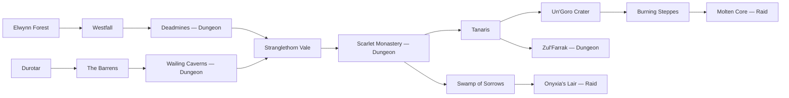

# A Classic Story

The ASR story progression defined by the user's exported `A Classic Story.svg`.

## Progression

The two starting routes converge at Stranglethorn Vale. Defeating the final boss
of a preceding zone opens the next connection. Either Deadmines or Wailing Caverns
opens Stranglethorn Vale. Progress is saved, and existing map indices stay stable.
Other zones remain in the atlas's **Other zones** tab for side adventures and race unlocks.

## Raid gates

Both raids require permanent **class level 50**, independent of a run's level.
This threshold is the initial implementation choice for the graph's "very high level" gate;
the class level cap is 52.

| Raid | Required zone clear | Quest to accept and turn in |
|---|---|---|
| Onyxia's Lair | Swamp of Sorrows | The Brood Mother's Trail |
| Molten Core | Burning Steppes | Attunement to the Core |

Accept the attunement in the quest log before clearing its zone, then turn it in.
The quest must be completed in the selected hero's current solo/realm economy.
Co-op hosts need the story route unlocked; every raid participant needs their own
class level and attunement. Co-op guests can follow the host through ordinary zones.

The co-op relay needs the updated arena and quest catalogs for the new zones.
Its arena list is shared with the client in `crates/asr-coop/src/story.rs`.

## Decisions still needed

- Armor selections per zone. Import only the armor the user selects for that zone.
- New-zone equipment rewards. Their tables are empty pending those selections;
  materials, quest rewards, and clear records work independently of equipment drops.
- Further tuning of encounter rosters, difficulty, and quest details.

## Source diagram

The supplied diagram is preserved at [story/a-classic-story.svg](story/a-classic-story.svg).
The SVG records the visible cards and connections; it does not preserve hidden
storyboard inspector fields. Export the storyboard as JSON to retain those fields.
